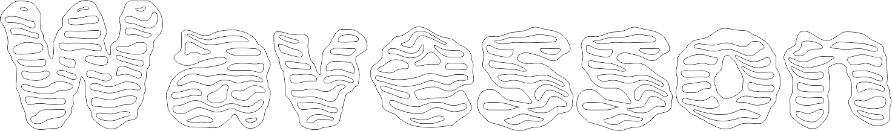
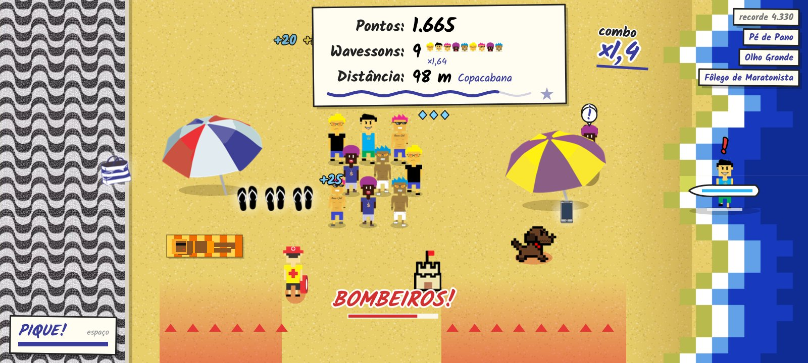
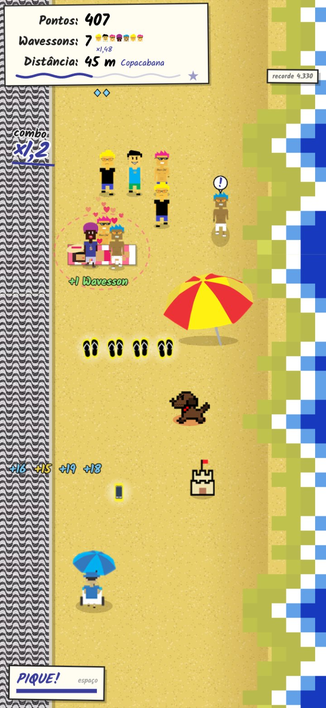

<div align="center">



**O arrastão roguelike infinito no calçadão.**

Você comanda o bando inteiro de uma vez, descendo a praia de Copacabana → Ipanema → Leblon → Barra,
pegando chinelo, celular e bolsa, recrutando a galera e fugindo de cachorro, surfista, bombeiros, viatura e da onda.

[](https://dreewr.github.io/wavesson/)
[](https://github.com/dreewr/wavesson/actions/workflows/pages.yml)
[](https://github.com/dreewr/wavesson/actions/workflows/ci.yml)




</div>

---

## Jogar

- **No navegador:** https://dreewr.github.io/wavesson/
- **No celular:** abra o link e use *Adicionar à tela inicial* — vira app, abre em tela cheia e funciona offline.
  Em pé ou deitado: cada orientação tem seu próprio enquadramento.
- **Desafio do dia:** a mesma praia pra todo mundo naquele dia. `?seed=QUALQUERCOISA` fixa a praia que você quiser.

| Ação | Teclado | Celular |
|---|---|---|
| Mover o bando | WASD / setas | arrastar o dedo |
| Pique | Espaço / Shift | botão PIQUE |
| Pausa | P / Esc | botão II |
| Som | M | — |
| Vantagem | 1 2 3 | tocar no cartão |

📖 **Tudo sobre inimigos, pontuação, vantagens e como a dificuldade sobe:** [`docs/JOGABILIDADE.md`](docs/JOGABILIDADE.md)
(gerado a partir do código — sempre em dia).

## O que tem

- **Praia infinita** gerada por seed, com passagem sempre garantida entre obstáculos.
- **Dificuldade que dá pra explicar:** curva por distância + **orçamento de ameaça** por fileira + **ritmo em serra**
  (a tensão sobe ao longo de cada praia e alivia na **Hora do Arrastão**). Calibrada por simulação.
- **Roguelike:** a cada trecho você escolhe 1 de 3 vantagens; bando grande e **combo** multiplicam pontos; **pique** com recarga.
- **Elenco:** cachorro nervoso, salva-vidas, carro de picolé, castelo de areia (de 2017) + surfista desatento,
  pelotão de bombeiros, viatura, onda, banhista que deixa o bando apaixonado (de 2026).
- **Ranking à prova de trapaça:** a simulação anda em passo fixo e grava os comandos, então a partida pode ser
  **refeita** do zero. O ranking local confere cada recorde; o online (opcional) confere no servidor.
- **Telemetria e estatísticas:** onde e do que você morre, mediana, histograma — e um relatório que junta
  dados de vários jogadores pra calibrar o jogo com gente de verdade.
- **Trilha original** sintetizada na hora ("Samba do Arrastão") + as faixas da hackathon no seletor.

## Rodar e mexer

Sem build e sem dependências — só Node 22+ pros testes e ferramentas.

```bash
npm start          # http://localhost:5173
npm test           # 28 testes: determinismo, replay, passagem garantida, orçamento, doc em dia...
npm run docs       # regera docs/JOGABILIDADE.md (obrigatório ao mexer em jogabilidade)
npm run build      # monta _site/ com versão carimbada (o deploy faz isso sozinho)
npm run analyze -- dados1.json dados2.json   # relatório de calibragem com exports dos jogadores
npm run verify -- dados.json                 # refaz e confere partidas gravadas
```

### Calibrando com jogadores reais

1. Cada um joga normalmente e, na tela **ranking & estatísticas**, toca em *exportar meus dados*.
2. Junte os arquivos e rode `npm run analyze -- *.json`: sai a mediana de distância, a taxa de morte precoce,
   as causas de morte, os trechos onde mais se perde gente, as vantagens mais escolhidas e pistas automáticas
   ("cachorro responde por 45% das perdas: pode estar forte ou mal sinalizado").
3. Ajuste os números em `src/difficulty.js` / `src/layout.js`, rode `npm test` e `npm run docs`, e publique.

## Como o código é organizado

```
src/
  run.js          regras e estado de uma partida — sem DOM, roda headless (testes e servidor)
  difficulty.js   curva de dificuldade, custos de ameaça, ritmo em serra
  generator.js    geração procedural das fileiras (pura, dirigida pelo orçamento)
  layout.js       enquadramentos horizontal (1600x720, o de 2017) e vertical (celular em pé)
  replay.js       passo fixo, gravação, replay e verificação de partidas
  defs.js         entidades: tamanho, hitbox e papel (perigo, sólido, item...)
  catalog.js      textos do bestiário (fonte da doc pública)
  perks.js        vantagens roguelike
  stats.js        estatísticas (jogo e ferramentas)
  telemetry.js    registro local das partidas, ranking local, export
  online.js       cliente do ranking online (opcional)
  render.js       canvas: praia, personagens, HUD
  audio.js        sons; synth-music.js é a trilha original
  main.js         telas, loop, cola tudo
tools/            stamp (build), gen-docs, analyze, verify-run
test/             node --test
docs/             JOGABILIDADE.md (gerada), RANKING-ONLINE.md, imagens
supabase/         schema e função de verificação do ranking online
legacy/           o projeto Construct 2 original de 2017
```

**Publicação:** todo push na `main` roda os testes, monta o site com a versão do commit carimbada em todos os
arquivos e publica no GitHub Pages. O jogo confere a versão ao abrir e se atualiza sozinho — nada de cache velho.

## História

Feito numa hackathon em janeiro de 2017 pela equipe **Wavesson02** — André Rodrigues, Henrique Hamilko,
Eduardo Hamilko e Maria Augusta — no Construct 2: um mapa fixo, seis integrantes e cada regra copiada seis vezes.
Em 2026 virou este roguelike, mantendo a arte, os menus e o HUD originais. O projeto de 2017 está em [`legacy/`](legacy/).

| 2017 (hackathon) | Hoje |
|---|---|
| Mapa fixo de 52.000 px montado à mão | Praia infinita por seed, com passagem garantida |
| Cada regra copiada 6× (uma por integrante) | Uma lista; o bando pode ter qualquer tamanho |
| Dificuldade constante | Curva + orçamento de ameaça + serra, calibrados por simulação e telemetria |
| Só cachorro e salva-vidas derrubavam; o Surfista Desatento só existia nas instruções | Surfista de verdade, bombeiros, viatura, onda, banhista |
| Botão Options sem função, músicas importadas e nunca tocadas | Seletor de música funcionando + trilha original |
| Só no computador | Celular em pé e deitado, instalável, offline |

## Pendências conhecidas

- **Arte unificada:** os sprites de 2017 convivem com personagens desenhados em código (bombeiros, banhista, viatura, surfista).
- **Tema:** "arrastão" nasceu como piada de hackathon; um lançamento aberto (lojas, divulgação) pede decidir se mantém ou reenquadra.
- **Ranking online:** pronto, mas desligado — ver [`docs/RANKING-ONLINE.md`](docs/RANKING-ONLINE.md).
- **Licença:** ainda não definida.

## Créditos

Arte, sprites, menus e o tema do menu: equipe Wavesson02 (2017). "Samba do Arrastão" é original do remake.

As faixas extras do seletor (Sweet Dreams, Naruto, A Grande Família e a vinheta do gás) pertencem aos seus autores
e estão aqui só pela memória afetiva da hackathon, num projeto pessoal e sem fins comerciais; se algum detentor pedir, elas saem.
